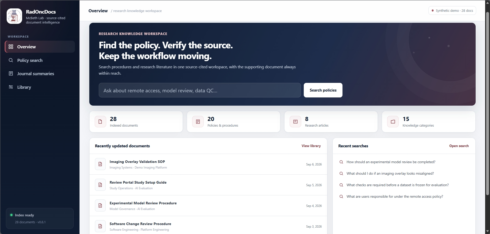
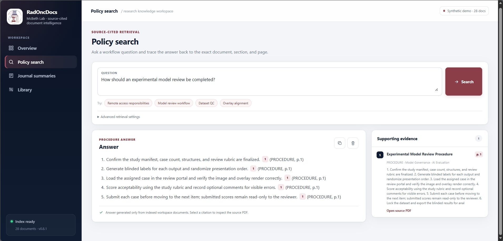
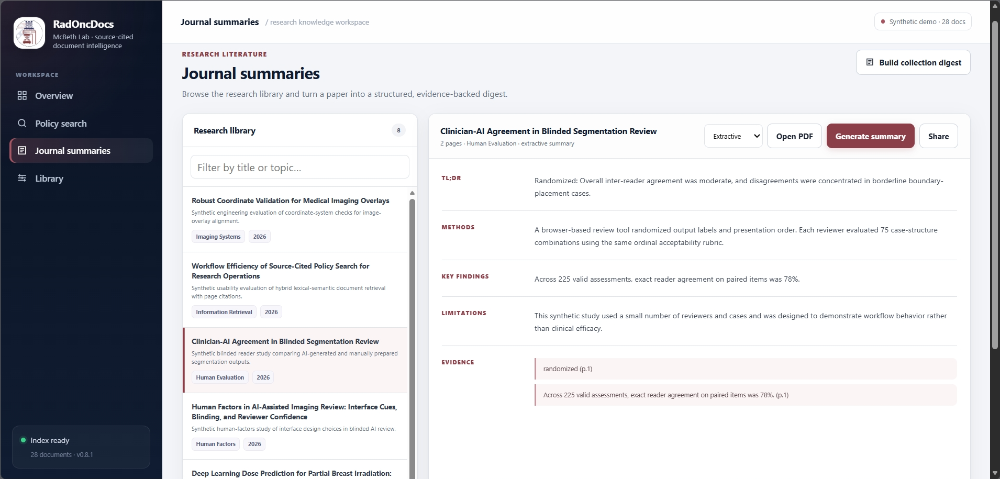

# RadOncDocs

RadOncDocs is a source cited document search and research summary application. The original internal version grew out of my research work in Penn Medicine Radiation Oncology. This repository is a portfolio safe public build with a completely synthetic corpus, fresh Git history, and no institutional source documents.

The goal is simple: make it fast to find an answer without hiding where that answer came from.


## What the app does

- Searches policies and procedures using BM25 lexical retrieval plus dense embeddings
- Returns concise extractive answers with document, section, and page citations
- Routes policy-only searches within the policy corpus before file ranking, preventing research papers from crowding out operational sources
- Detects step-based questions and extracts ordered procedures
- Prioritizes an explicitly named policy or SOP instead of diluting the answer with loosely related documents
- Lets users open the cited PDF directly from a result
- Browses and filters a structured document library
- Generates extractive research-paper summaries with methods, findings, limitations, and page-linked evidence
- Stores recent searches locally in the browser so the workspace feels persistent without requiring user accounts
- Keeps administration disabled by default in the public build

## Screenshots

### Overview



### Source-cited policy search



### Research article summaries



## Public demo corpus

The repository ships with **28 synthetic PDFs** so the interface and retrieval system can be exercised realistically without exposing internal material:

- **20 policies and procedures** covering access/security, data governance, dataset QC, model review, imaging-overlay validation, software change review, HPC workflows, inference, annotation QA, and study operations
- **8 research articles** covering segmentation, dose prediction, blinded human evaluation, uncertainty, information retrieval, human factors, and imaging coordinate validation

Every included PDF is synthetic and generated specifically for this public repository. Document metadata is stored in `data/demo/manifest.json`, which gives the application realistic titles, owners, categories, update dates, descriptions, and research metadata without scraping filenames.

The corpus is reproducible:

```bash
pip install -e ".[demo]"
python scripts/generate_demo_corpus.py
```

## Architecture

```text
Synthetic PDFs + manifest metadata
             |
             v
      PyMuPDF extraction
             |
      +------+------+
      |             |
 policy chunks   section-aware
                  journal chunks
      |             |
      +------+------+
             |
             v
 BM25 + BGE embeddings / Chroma
             |
             v
 hybrid retrieval + relevance filtering
             |
      +------+------+
      |             |
 named-doc /      extractive
 procedure        synthesis
 routing
      |             |
      +------+------+
             |
             v
          FastAPI
             |
             v
 browser workspace + source PDF preview
```

## Repository layout

```text
api/              FastAPI routes for Q&A, document listing, and summaries
rag/              BM25, semantic retrieval, reranking, and optional answer writer
ingest/           PDF parsing, chunking, metadata extraction, and indexing
ui/               Browser application and independent RadOncDocs branding
scripts/          Smoke tests, safety checks, and synthetic corpus generation
data/demo/        Synthetic policy and journal PDFs plus manifest metadata
site/             Generated shareable summary pages
```

## Quick start

Python 3.12 is recommended, especially on Windows.

### Conda

```bash
conda create -n radoncdocs python=3.12 -y
conda activate radoncdocs
python -m pip install -e . --no-build-isolation
```

### Standard venv

```bash
python -m venv .venv
```

Activate it:

```bash
# macOS / Linux
source .venv/bin/activate

# Windows PowerShell
.\.venv\Scripts\Activate.ps1
```

Then install:

```bash
python -m pip install -e .
```

Build the local search index:

```bash
python -m ingest.ingest --rebuild
```

Start the app:

```bash
python main.py
```

Open:

```text
http://127.0.0.1:8000
```

If that port is already in use:

```powershell
$env:RADONCDOCS_PORT="8010"
python main.py
```

The first index build downloads the embedding model locally and may take a few minutes.

## Verify the release candidate

With the server running:

```bash
python scripts/smoke_test.py
```

For another port:

```powershell
$env:RADONCDOCS_BASE_URL="http://127.0.0.1:8010"
python scripts/smoke_test.py
```

The v0.8 smoke test checks API health, corpus metadata, named-policy routing, section-aware dataset-QC answers, overlay troubleshooting, answer boilerplate cleanup, source-file links, and research summarization.

A static safety check is also included:

```bash
python scripts/safety_check.py
```

## Questions worth trying

```text
What are users responsible for under the remote access policy?
How should an experimental model review be completed?
What checks are required before a dataset is frozen for evaluation?
What should I do if an imaging overlay looks misaligned?
What steps should be taken after a suspected access incident?
What must be recorded when running batch model inference?
```

## Interface design

The public build is structured like an internal research product rather than a chatbot:

- **Overview** surfaces corpus health, collections, recently updated documents, and recent local searches.
- **Policy search** keeps the answer and supporting evidence side by side. Citation markers open the relevant PDF page.
- **Journal summaries** uses a paper browser and structured reading workspace instead of a single text dump.
- **Library** exposes document type, category, owner, update date, and direct PDF preview.


## Optional local LLM writer

The default public build does not require an LLM to answer policy questions. Its normal path is retrieval plus deterministic extractive synthesis, which keeps setup lighter and makes the grounding behavior easier to inspect.

An optional source-constrained writer can be enabled locally:

```bash
export RADONCDOCS_ENABLE_WRITER=1
```

The research summarizer also supports an optional abstractive mode. Extractive mode remains the default because it is faster and does not require a large summarization model.

## Data safety

This repository is deliberately separated from the original internal project:

- no institutional policies or procedures
- no patient or clinical source data
- no internal Chroma index or extracted text cache
- no internal generated summaries
- no secrets or credentials
- no copied private Git history
- administrative write routes disabled by default

See [SECURITY.md](SECURITY.md) for more detail.

## Technical stack

- Python / FastAPI
- BM25
- BGE sentence embeddings
- Chroma
- PyMuPDF
- Sentence Transformers / Hugging Face Transformers
- Vanilla JavaScript, HTML, and CSS


